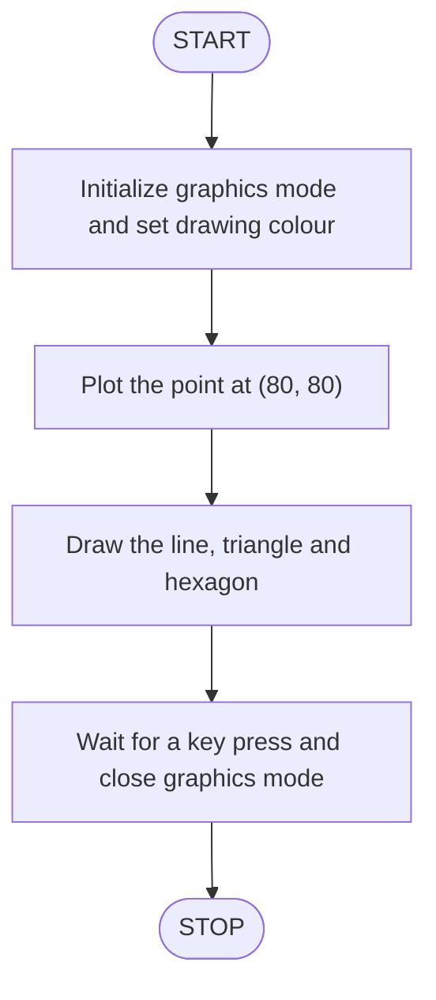

# Practical 1: Basic Graphics Primitives

## Problem Statement
Implement and display basic Graphics primitives such as points, lines, and polygons.

## Aim
Implement and display a point, a line and polygons using basic graphics primitives.

## Theory
Every picture is built from a few basic primitives. `graphics.h` gives a ready function for each:

| Primitive | Function |
|-----------|----------|
| Point | `putpixel(x, y, color)` |
| Line | `line(x1, y1, x2, y2)` |
| Polygon | a closed chain of `line()` calls (or `drawpoly`) |

## Algorithm
```
01. START
02. Initialize the graphics mode.
03. Set the drawing colour and background colour.
04. Plot a point at (80, 80).
05. Draw a line from (100, 150) to (400, 150).
06. Draw a triangle by joining (200, 100), (100, 300) and (300, 300).
07. Draw a hexagon by joining (250, 100), (350, 150), (350, 250),
    (250, 300), (150, 250) and (150, 150).
08. Wait for a key press.
09. Close graphics mode.
10. STOP
```
The last vertex of each polygon is joined back to the first vertex to close the shape.

## Flowchart


## Requirements
- Language: C / C++
- Compiler: Turbo C++ with BGI drivers

## Files
- `main.cpp`: point + line + triangle + hexagon (matches the algorithm above)
- `examples/line.cpp`: line only, with its output
- `examples/hexagon.cpp`: hexagon only, with its output

## How to Run
Open `main.cpp` in Turbo C++ (BGI folder at `C:\TURBOC3\BGI`), press `Alt + F9` to compile and `Ctrl + F9` to run.

## Output
Line (`examples/line.cpp`):


Hexagon (`examples/hexagon.cpp`):


## Viva Questions

1. **What is a graphics primitive?**
   **Answer:** The basic building block of a drawing, such as a point, line or polygon.

2. **What does `initgraph()` do?**
   **Answer:** It switches the screen to graphics mode and loads the graphics driver. `DETECT` lets it pick the driver and mode automatically.

3. **What is the BGI path?**
   **Answer:** The folder that holds the Borland Graphics Interface driver files (`.bgi`), which `initgraph()` needs.

4. **How do you plot a single point?**
   **Answer:** With `putpixel(x, y, color)`, which colours the pixel at (x, y).

5. **How is a polygon drawn using `line()`?**
   **Answer:** Join each vertex to the next one, and join the last vertex back to the first so the shape is closed.

6. **Why is `getch()` used?**
   **Answer:** It holds the output screen until a key is pressed, otherwise the window closes immediately.
