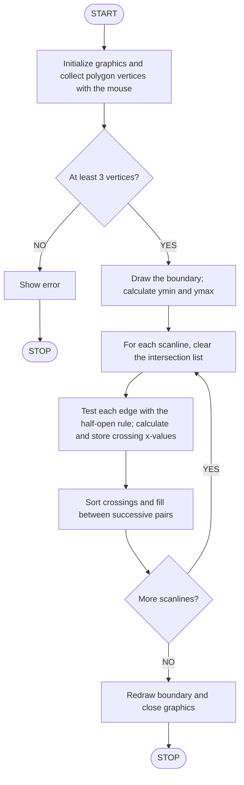
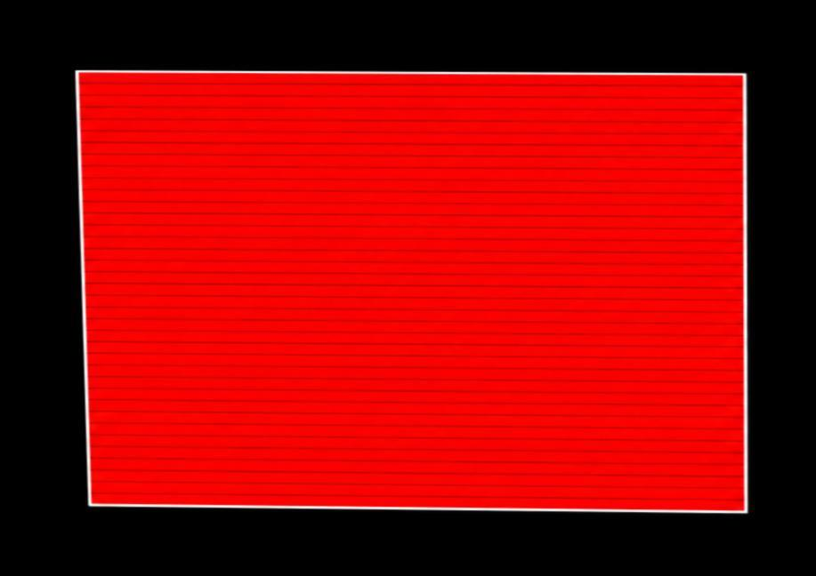

# Practical 2: Concave Polygon Filling (Scan Line Algorithm)

## Problem Statement
Write a program to draw a concave polygon and fill it with desired pattern using scan line algorithm. Use mouse interfacing to draw polygons.

## Aim
Capture a polygon using mouse input and fill it using the scan-line algorithm.

## Theory
The scan-line algorithm fills a polygon one horizontal line (scanline) at a time. For each scanline it finds where the line crosses the polygon edges, sorts the crossings from left to right, and fills between the 1st and 2nd, 3rd and 4th, ... crossing (odd-even rule). This works for concave polygons too, because a scanline can cross the boundary more than twice.

## Algorithm
```
01. START
02. Initialize graphics mode; set vertex_count = 0.
03. Repeat: read a mouse click and append its (x, y) coordinate to the vertex list.
04. Stop collecting vertices when the user finishes input (right-click).
05. If vertex_count < 3, display "Invalid polygon" and STOP.
06. Draw the polygon boundary; calculate ymin and ymax from all vertices.
07. FOR each integer scanline y from ceil(ymin) through floor(ymax):
08.     Set intersections = an empty list.
09.     FOR each polygon edge (xi, yi) to (xj, yj):
10.         Ignore horizontal edges.
11.         Apply the half-open test: (yi <= y < yj) OR (yj <= y < yi).
12.         If the test is true, calculate x = xi + (y - yi) * (xj - xi) / (yj - yi).
13.         Append x to intersections.
14.     END FOR
15.     Sort intersections in ascending order.
16.     Fill between consecutive pairs: (x1, x2), (x3, x4), and so on.
17. END FOR
18. Redraw the polygon boundary; wait for a key press; close graphics mode.
19. STOP
```
Horizontal edges are skipped because they do not cross a scanline under the half-open rule. The strict upper endpoint prevents a shared polygon vertex from being counted twice. Intersections are sorted before filling pairs.

## Flowchart


## Requirements
- Language: C / C++
- Compiler: Turbo C++ with BGI drivers, and a mouse (works in DOSBox / Turbo C++ IDE)

## Files
- `main.cpp`: concave polygon drawn with the mouse and filled with the scan-line algorithm (follows the algorithm above). Left click adds a vertex, right click finishes. The fill pattern is bands of 4 scanlines alternating RED and YELLOW.
- `rectangle_fill.cpp`: simple scan-line fill of a rectangle, with its output

## How to Run
Open `main.cpp` in Turbo C++ (BGI folder at `C:\TURBOC3\BGI`), press `Alt + F9` to compile and `Ctrl + F9` to run. Click the vertices on the screen, then right-click to fill.

## Output
Rectangle fill (`rectangle_fill.cpp`):



## Viva Questions

1. **What is the scan-line algorithm?**
   **Answer:** A polygon-filling method that processes one horizontal line at a time: find the edge crossings, sort them, and fill between pairs.

2. **Why do we sort the intersections?**
   **Answer:** The edges are not met in left-to-right order, so the x-values must be sorted before pairing them as fill spans.

3. **What is the odd-even rule?**
   **Answer:** Crossings are paired (1st-2nd, 3rd-4th, ...). Between an odd and the next even crossing the scanline is inside the polygon.

4. **Why is the half-open test (yi <= y < yj) used?**
   **Answer:** So that a vertex shared by two edges is counted once, not twice, which would otherwise break the pairing.

5. **Why are horizontal edges ignored?**
   **Answer:** They are parallel to the scanline, so they have no single crossing point (and yj - yi would be zero).

6. **What is a concave polygon?**
   **Answer:** A polygon with at least one interior angle greater than 180 degrees, so a line can cut its boundary more than twice.

7. **How is the mouse read in Turbo C?**
   **Answer:** Through interrupt 33h using `int86()`. Function 0 initializes, 1 shows, 2 hides and 3 reads the position and button status.
