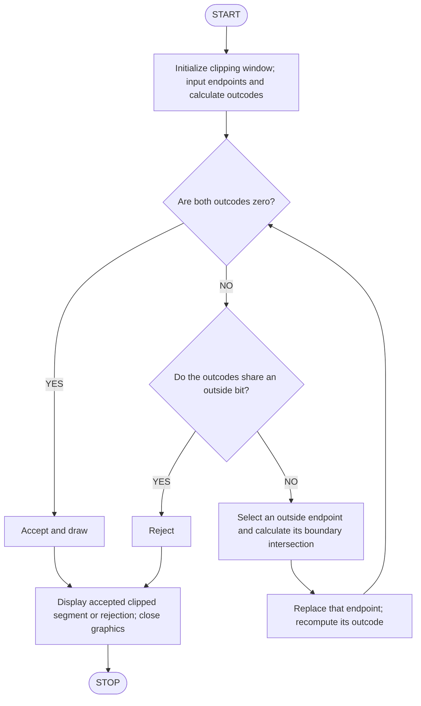
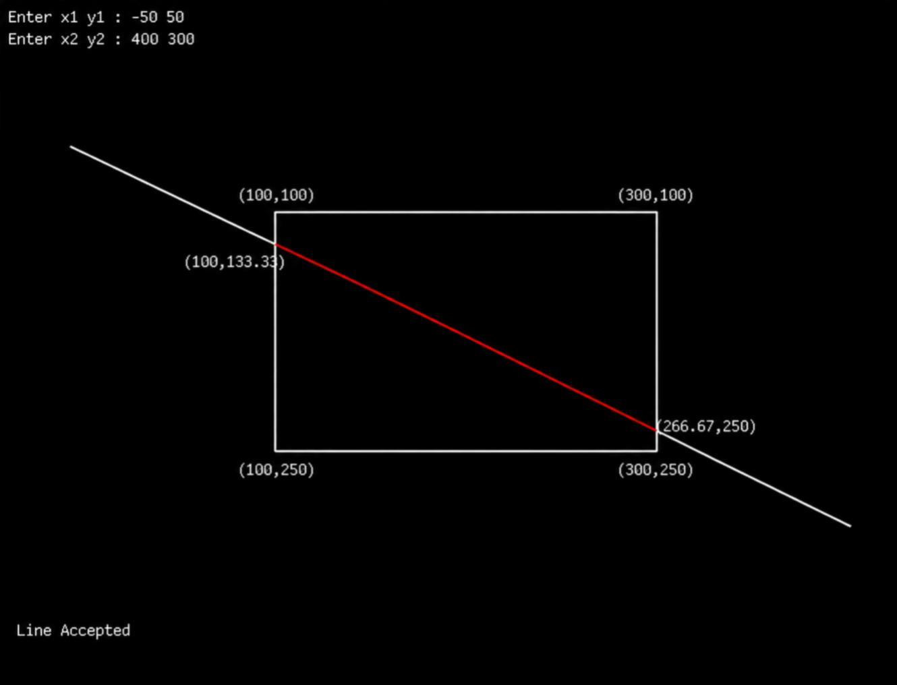

# Practical 3: Cohen-Sutherland Line Clipping

## Problem Statement
To implement Cohen-Sutherland 2D clipping Algorithm.

## Aim
Clip a 2D line segment against a rectangular clipping window using the Cohen-Sutherland algorithm.

## Theory
Every endpoint gets a 4-bit region code (outcode) that tells where it lies relative to the window.

| Bit | Value | Meaning |
|-----|-------|---------|
| LEFT | 0001 | x < xmin |
| RIGHT | 0010 | x > xmax |
| TOP | 0100 | y < ymin |
| BOTTOM | 1000 | y > ymax |

- Both codes 0000: the line is fully inside, **accept**.
- Bitwise AND of the two codes is not 0: both ends are outside on the same side, **reject**.
- Otherwise the line is clipped at a window boundary and the test is repeated.

## Algorithm
```
01. START
02. Initialize graphics mode; define the clipping window (xmin, ymin) to (xmax, ymax).
03. Read the line endpoints P1(x1, y1) and P2(x2, y2).
04. Calculate the 4-bit outcodes c1 and c2 for the two endpoints.
05. REPEAT:
06.     If (c1 OR c2) = 0, ACCEPT the segment and leave the loop.
07.     Else if (c1 AND c2) != 0, REJECT the segment and leave the loop.
08.     Otherwise, select an endpoint whose outcode is non-zero.
09.     Choose one set boundary bit from that endpoint's outcode.
10.     If TOP or BOTTOM is set, set y to ymin or ymax and calculate:
11.         x = x1 + (x2 - x1) * (y - y1) / (y2 - y1).
12.     Else if LEFT or RIGHT is set, set x to xmin or xmax and calculate:
13.         y = y1 + (y2 - y1) * (x - x1) / (x2 - x1).
14.     Replace the selected endpoint and recompute its outcode.
15. UNTIL the segment is accepted or rejected.
16. If accepted, draw the clipped segment; otherwise display "Rejected".
17. Wait for a key press; close graphics mode.
18. STOP
```

## Flowchart


## Requirements
- Language: C / C++
- Compiler: Turbo C++ with BGI drivers

## How to Run
Open `main.cpp` in Turbo C++ (BGI folder at `C:\TURBOC3\BGI`), press `Alt + F9` to compile and `Ctrl + F9` to run.

Clipping window used: (100, 100) to (300, 250). Sample input: `-50 50` and `400 300`.

## Output
White line = original, red line = clipped part inside the window.



## Viva Questions

1. **What is clipping?**
   **Answer:** Removing the part of a picture that lies outside a chosen window, so only the visible part is drawn.

2. **What is a region code (outcode)?**
   **Answer:** A 4-bit code for a point: one bit each for LEFT, RIGHT, TOP and BOTTOM, set when the point is outside on that side.

3. **When is a line trivially accepted?**
   **Answer:** When both endpoint codes are 0000, so both points are inside the window.

4. **When is a line trivially rejected?**
   **Answer:** When the bitwise AND of the two codes is not zero, which means both points are outside on the same side.

5. **Why is the algorithm repeated in a loop?**
   **Answer:** One clip moves an endpoint to a boundary but the new point may still be outside another boundary, so the tests are repeated until accept or reject.

6. **How is the intersection with a boundary found?**
   **Answer:** From the line equation: for a vertical boundary x = xmin or xmax, y = y1 + slope * (x - x1); for a horizontal boundary y = ymin or ymax, x = x1 + (y - y1) / slope.

7. **What happens if a line is outside but its codes do not share a bit?**
   **Answer:** It is not trivially rejected. It is clipped step by step, and may finally be rejected after clipping.
