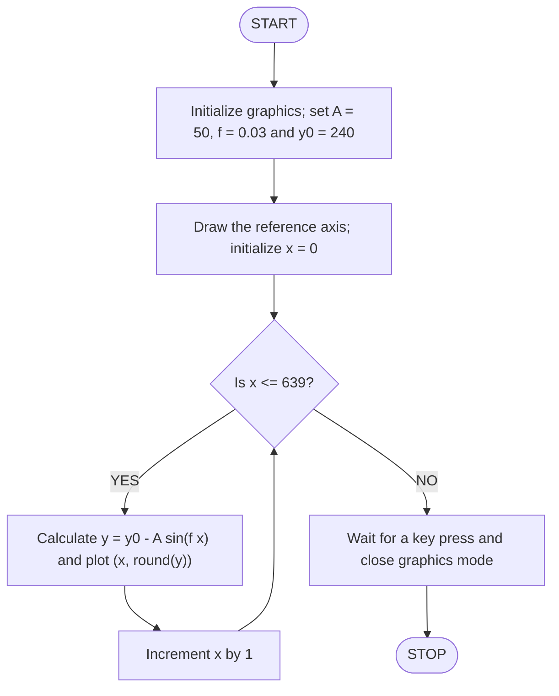

# Practical 4: Curve Generation (Sine Wave)

## Problem Statement
Write a program to draw any object such as flower, waves using any curve generation.

## Aim
Generate and display a sine wave using a point-by-point curve-generation method.

## Theory
A curve can be drawn by calculating y for every x from its equation and plotting each point. The sine wave is

`y = y0 - A * sin(f * x)`

- `A` (amplitude) controls the wave height
- `f` (frequency) controls how quickly the wave oscillates
- `y0` is the vertical centre (midline) of the wave
- The angle `f * x` is in radians. The screen's y-axis points downward, so the value is subtracted from `y0`.

## Algorithm
```
01. START
02. Initialize graphics mode.
03. Set amplitude A = 50, frequency f = 0.03 and midline y0 = 240.
04. Draw the horizontal reference axis at y = y0.
05. Set x = 0.
06. WHILE x <= 639:
07.     Calculate y = y0 - A * sin(f * x).
08.     Plot the pixel at (x, round(y)).
09.     Set x = x + 1.
10. END WHILE
11. Wait for a key press; close graphics mode.
12. STOP
```
The loop covers the 640 horizontal pixel positions from 0 through 639.

## Flowchart


## Requirements
- Language: C / C++
- Compiler: Turbo C++ with BGI drivers (`math.h` for `sin()`)

## How to Run
Open `main.cpp` in Turbo C++ (BGI folder at `C:\TURBOC3\BGI`), press `Alt + F9` to compile and `Ctrl + F9` to run.

## Output
Add your screenshot here as `output.png`.

## Viva Questions

1. **What is curve generation?**
   **Answer:** Drawing a curve by calculating its points from an equation and plotting them one by one.

2. **What do A, f and y0 control in the sine wave?**
   **Answer:** A is the height of the wave, f is how fast it oscillates (how many waves fit on the screen), and y0 is the vertical centre line.

3. **Why is the angle in radians?**
   **Answer:** The `sin()` function of `math.h` takes radians, not degrees.

4. **Why is the sine term subtracted from y0?**
   **Answer:** On the screen, y increases downward, so subtracting makes the wave go up for positive values of sine.

5. **Why is `putpixel()` used instead of `line()`?**
   **Answer:** The curve is plotted point by point; with a step of 1 pixel the points form a smooth-looking wave.

6. **Name other curves that can be generated.**
   **Answer:** Circle, ellipse, Bezier curve and B-spline. A flower can be made from a polar equation such as r = a * cos(k * theta).
