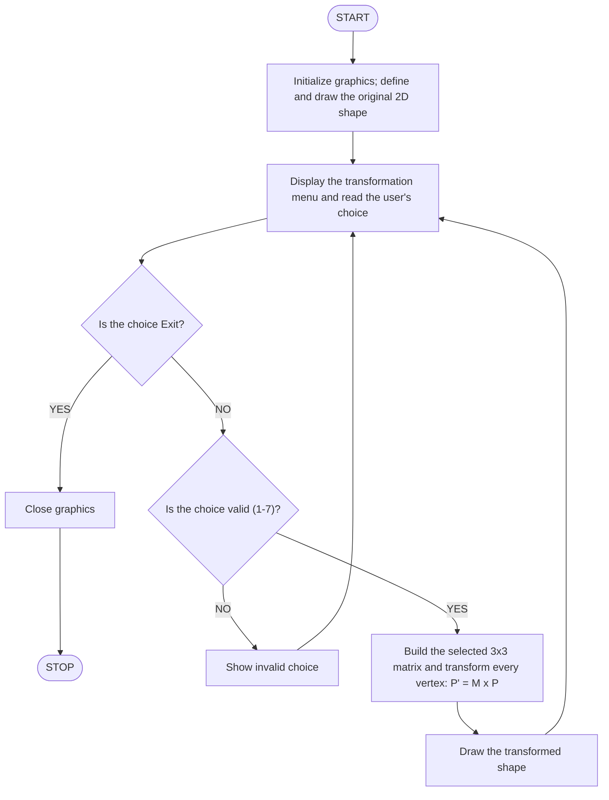
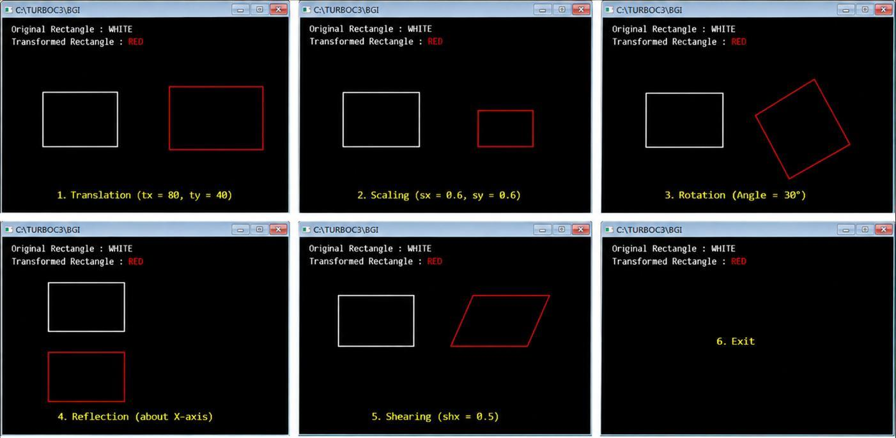

# Practical 5: 2D Transformations

## Problem Statement
Implement 2D transformations including translation, shearing, rotation, reflection, and scaling.

## Aim
Apply translation, scaling, rotation, reflection and shearing to a 2D shape (a rectangle) using homogeneous coordinates.

## Theory
A 2D point (x, y) is written as the column vector P = [x, y, 1]^T, so every transformation becomes one 3x3 matrix multiplication: P' = M x P.

| Transformation | Matrix M |
|----------------|----------|
| Translation | [[1, 0, tx], [0, 1, ty], [0, 0, 1]] |
| Scaling | [[sx, 0, 0], [0, sy, 0], [0, 0, 1]] |
| Rotation | [[cos t, -sin t, 0], [sin t, cos t, 0], [0, 0, 1]] |
| X-axis reflection | [[1, 0, 0], [0, -1, 0], [0, 0, 1]] |
| Y-axis reflection | [[-1, 0, 0], [0, 1, 0], [0, 0, 1]] |
| X-shear | [[1, shx, 0], [0, 1, 0], [0, 0, 1]] |
| Y-shear | [[1, 0, 0], [shy, 1, 0], [0, 0, 1]] |

All matrices transform about the origin. For rotation or scaling about a shape's centre: translate to the origin, transform, then translate back.

## Algorithm
```
01. START
02. Initialize graphics mode and define the original shape as column vertices P = [x, y, 1]^T.
03. Draw the original shape.
04. REPEAT:
05.     Display menu: 1 Translation, 2 Scaling, 3 Rotation,
06.                   4 X-axis reflection, 5 Y-axis reflection,
07.                   6 X-shear, 7 Y-shear, 8 Exit.
08.     Read choice.
09.     If choice = 8, leave the loop.
10.     Construct the selected 3x3 homogeneous transformation matrix M.
18.     For every original vertex, calculate P' = M x P.
19.     Clear the drawing area and draw the transformed shape.
20. UNTIL choice = 8.
21. Close graphics mode.
22. STOP
```

## Flowchart


## Implementation note
The program offers 6 menu options (Translation, Scaling, Rotation, Reflection about the X-axis, Shearing along X, Exit) and applies the matrix operations as direct formulas (for example x' = x + tx, y' = y + ty) instead of building the 3x3 matrix. The result is the same as P' = M x P. Rotation and scaling are about the origin (0, 0).

## Requirements
- Language: C / C++
- Compiler: Turbo C++ with BGI drivers (`math.h` for `sin()` and `cos()`)

## How to Run
Open `main.cpp` in Turbo C++ (BGI folder at `C:\TURBOC3\BGI`), press `Alt + F9` to compile and `Ctrl + F9` to run. Choose an option 1 to 6 from the menu and enter the values.

## Output
White rectangle = original, red rectangle = transformed.



## Viva Questions

1. **What are homogeneous coordinates?**
   **Answer:** Writing a 2D point (x, y) as (x, y, 1) so that translation, which is an addition, can also be done by matrix multiplication.

2. **Why is a 3x3 matrix used for 2D transformations?**
   **Answer:** With the extra coordinate, translation, scaling, rotation, reflection and shear all become 3x3 matrices, and combined transformations are just matrix products.

3. **Write the rotation formula.**
   **Answer:** x' = x cos(t) - y sin(t) and y' = x sin(t) + y cos(t), about the origin, counter-clockwise for positive t.

4. **How do you rotate about a point other than the origin?**
   **Answer:** Translate that point to the origin, rotate, then translate back.

5. **What is reflection about the X-axis?**
   **Answer:** (x, y) becomes (x, -y). In this program, on screen coordinates, it is done as y' = 480 - y.

6. **What is shearing?**
   **Answer:** It slants the shape. X-shear moves each point sideways by an amount proportional to its y: x' = x + shx * y, y' = y.

7. **Is the order of transformations important?**
   **Answer:** Yes. Matrix multiplication is not commutative, so translate-then-rotate gives a different result than rotate-then-translate.
