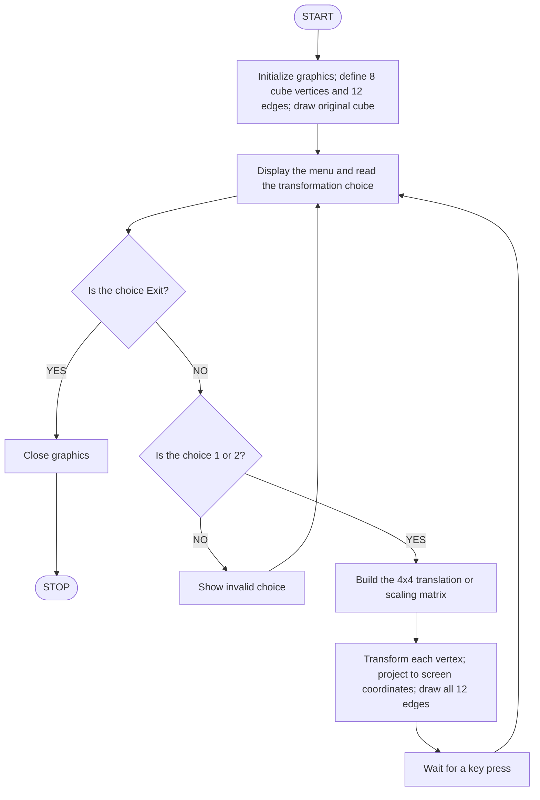
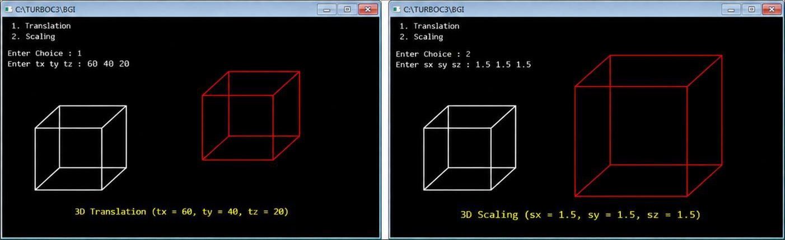

# Practical 6: 3D Points and Transformations Using Homogeneous Coordinates

## Problem Statement
Implement a program to represent 3D points and transformations using homogeneous coordinates.

## Aim
Represent 3D points in homogeneous coordinates and apply translation or scaling to a 3D object (a cube).

## Theory
A 3D point (x, y, z) is written as P = [x, y, z, 1]^T, and every transformation is a 4x4 matrix: P' = M x P.

| Transformation | Matrix M |
|----------------|----------|
| Translation | [[1, 0, 0, tx], [0, 1, 0, ty], [0, 0, 1, tz], [0, 0, 0, 1]] |
| Scaling | [[sx, 0, 0, 0], [0, sy, 0, 0], [0, 0, sz, 0], [0, 0, 0, 1]] |

The cube has 8 vertices and 12 edges. To show it on a 2D screen a simple oblique projection can be used: X = x + 0.5z and Y = y + 0.5z.

## Algorithm
```
01. START
02. Initialize graphics mode.
03. Define the 8 cube vertices as column vectors P = [x, y, z, 1]^T.
04. Store the 12 cube edges and draw the original cube.
05. REPEAT:
06.     Display menu: 1 Translation, 2 Scaling, 3 Exit.
07.     Read choice.
08.     If choice = 3, leave the loop.
09.     If choice = 1, read tx, ty, tz and construct the 4x4 translation matrix.
11.     Else if choice = 2, read sx, sy, sz and construct the 4x4 scaling matrix.
13.     Else display "Invalid choice" and return to the menu.
14.     For each original vertex, calculate P' = M x P.
15.     Project each transformed 3D point to 2D screen coordinates.
16.     Clear the drawing area and draw the 12 cube edges.
17.     Wait for a key press.
18. UNTIL choice = 3.
19. Close graphics mode.
20. STOP
```

## Flowchart


## Implementation note
The program runs one operation (Translation or Scaling) per run. The transformation is applied as direct formulas on each vertex (x += tx, or x *= sx), which is the same as P' = M x P. The cube is stored with its back face already shifted by (+40, -40) on the screen, so `drawCube()` uses only x and y and no extra projection is applied. Scaling is about the origin (0, 0), so the cube also moves away from its position when it is scaled.

## Requirements
- Language: C / C++
- Compiler: Turbo C++ with BGI drivers

## How to Run
Open `main.cpp` in Turbo C++ (BGI folder at `C:\TURBOC3\BGI`), press `Alt + F9` to compile and `Ctrl + F9` to run. Choose 1 or 2 and enter the values.

## Output
White cube = original, red cube = transformed.



## Viva Questions

1. **Why are homogeneous coordinates used in 3D?**
   **Answer:** A 4th coordinate (1) lets translation be written as a 4x4 matrix too, so all transformations are matrix multiplications and can be combined.

2. **What is the size of a 3D transformation matrix?**
   **Answer:** 4x4.

3. **Write the 3D translation matrix.**
   **Answer:** Identity matrix with tx, ty, tz in the last column: [[1,0,0,tx],[0,1,0,ty],[0,0,1,tz],[0,0,0,1]].

4. **What does scaling about the origin do?**
   **Answer:** It multiplies each coordinate by sx, sy, sz, so the object also moves away from (or towards) the origin. To scale about the object's own centre, translate to the origin, scale, and translate back.

5. **How many vertices and edges does a cube have?**
   **Answer:** 8 vertices and 12 edges.

6. **How is a 3D object shown on a 2D screen?**
   **Answer:** By projection. Here an oblique projection is used: X = x + 0.5z and Y = y + 0.5z.
